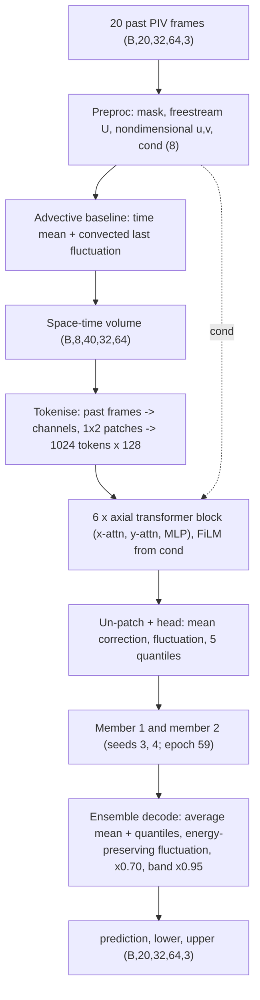

# PhysicsOracle: NeurIPS 2026 RealPDE Track 1 (Simulation-to-Real)

Team **PhysicsOracle**'s model for the [NeurIPS 2026 RealPDE Competition](https://www.codabench.org/),
Track 1: *Simulation-to-Real Transfer Learning*. The repository contains exactly what is needed to

1. **train** the two ensemble members ([docs/TRAINING.md](docs/TRAINING.md)),
2. **build the submission** zip that runs on the evaluation server ([docs/SUBMISSION.md](docs/SUBMISSION.md)),
3. **understand the model** ([docs/ARCHITECTURE.md](docs/ARCHITECTURE.md)).

The trained weights of the final submission are included in [`weights/`](weights/).

## The challenge

Cross-sectional flow around a NACA 4418 airfoil, measured with PIV (particle image velocimetry) and simulated with CFD.

| | |
|---|---|
| Input | the last **20 frames** of a real PIV measurement, `u, v` (and `p = 0`), on a **32 x 64** grid: `(N, 20, 32, 64, 3)` |
| Output | the **next 20 frames** `(N, 20, 32, 64, 3)` **plus an uncertainty band** `lower`, `upper` of the same shape |
| Training data | *real*: 81 PIV trajectories (`u, v`, Re 3,750-26,700, angle of attack 0-20 deg); *sim*: 100 CFD trajectories (`u, v, p`) covering the same range and more |
| Transfer | simulation is plentiful but differs from the experiment; the test inputs are **real** measurements, partly at Reynolds numbers / angles not seen in the real training data |
| Scoring | five 0-100 subscores combined into `final_score`: **rel_l2** (field error), **tke** (turbulent kinetic energy map), **mvpe** (time-mean velocity at wake probes), **sps** (sharpness-penalised coverage of the uncertainty band), **time** (inference speed) |

The evaluation server calls `predict(input_array, metadata) -> {"prediction", "lower", "upper"}` in a fresh process
with `pytorch/pytorch:2.2.2-cuda12.1-cudnn8-runtime` (torch, numpy and the standard library only).

## The model in one picture




The network does not predict the flow from scratch: a physics scaffold (freestream estimate, mask geometry, a
convected-turbulence baseline) turns the input into a nondimensional space-time volume, and a 3.4 M-parameter axial
transformer predicts the **correction** to the baseline, a **fluctuation** field and **quantiles** for the band.
Two members trained with different seeds are combined in one ahead-of-time compiled graph.

## Result

Development-phase hidden leaderboard (submission `FINAL`, 27 Sep 2026):

| rel_l2 | tke | mvpe | time | sps | **final_score** |
|---|---|---|---|---|---|
| 94.892 | 79.708 | 94.216 | 91.862 | 44.377 | **82.010** |

## Quick start

```bash
# environment (python 3.10, torch 2.2.2 + CUDA 12.1, numpy 1.26)
uv sync                      # or: pip install torch==2.2.2 --index-url https://download.pytorch.org/whl/cu121 && pip install numpy==1.26.4 pyyaml h5py

# 1. data: download the public training data and build the 32x64 cache (docs/TRAINING.md)
python tools/make_cache.py --raw /path/to/raw          # -> data/cache32/{real,sim}/*.npz

# 2. train the two members (about 2 h each on one RTX 4090 / A100)
python -m rpde.train --config configs/final.yaml --fold full --seed 3 --name fm_all_s3
python -m rpde.train --config configs/final.yaml --fold full --seed 4 --name fm_all_s4

# 3. build the submission from the epoch-59 snapshots (or from weights/ directly)
python tools/make_sample_inputs.py
for b in 5,10 2,4 3,1; do
  python tools/aot_build_ens.py build/aot runs/fm_all_s3/ep59.pth,runs/fm_all_s4/ep59.pth \
      gamma=0.70 band_scale=0.95 energy_preserve=1 batches=$b
done
python tools/pack_submission.py --aot build/aot --members runs/fm_all_s3/ep59.pth runs/fm_all_s4/ep59.pth
```

## Repository layout

```
configs/final.yaml          the training recipe of both members
rpde/                       model, data pipeline, losses, training loop, ensemble decode
  scaffold.py               Preproc, advective baseline, input volume, head, RPDEModel
  cores/axial.py            the axial transformer core
  data.py                   cache loading, windows, sim-to-real augmentation, mirror augmentation
  losses.py, decode.py      training losses; quantile band decode
  train.py                  training loop (EMA, cosine schedule, snapshots)
  ensemble_predict.py       2-member combine + decode (the graph that is compiled for submission)
  gated_decode.py           decode adjustment for Reynolds numbers above the training range
  fastinf.py, aot_runner.py fp16 fast path used for compilation; compiler-free loader
submission/submission.py    the predict() runtime that ships in the zip
tools/                      data cache, sample inputs, AOT build, checkpoint stripping, packing
weights/                    the two final members (EMA weights, epoch 59)
third_party/realpde_kit/    the organisers' scoring reference (used for validation)
docs/                       ARCHITECTURE, TRAINING, SUBMISSION, architecture.svg
```
