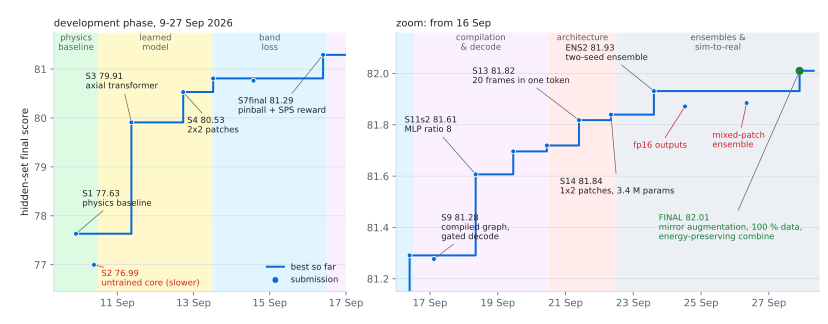
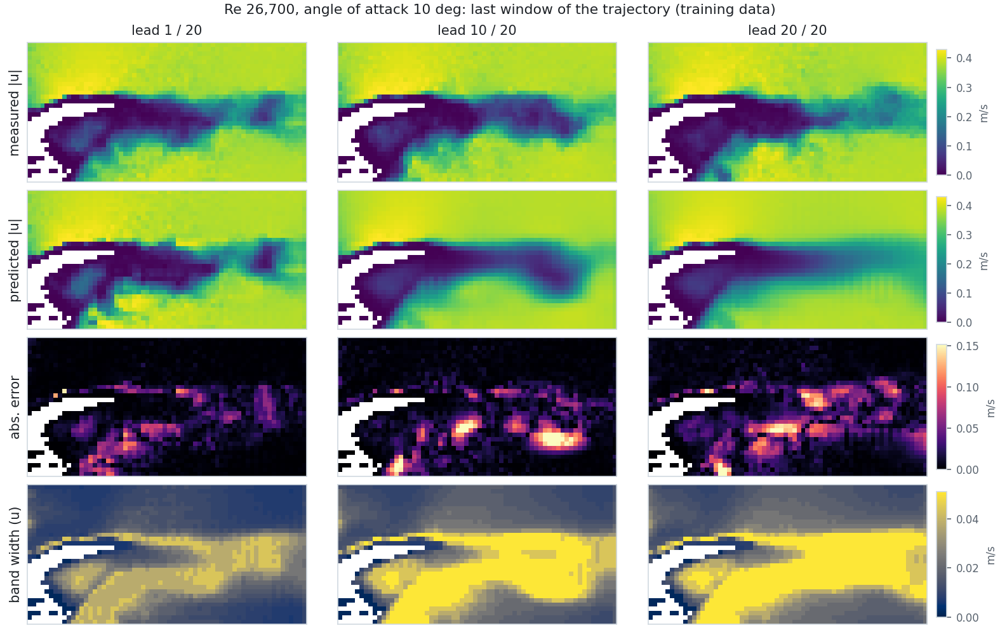

<div align="center">

# PhysicsOracle

**Forecasting real turbulent airfoil flow from simulation and experiment**

Team PhysicsOracle · NeurIPS 2026 RealPDE Competition, Track 1: Simulation-to-Real Transfer Learning


-0969da)


</div>

This repository holds the model of team PhysicsOracle for the NeurIPS 2026 RealPDE Competition, Track 1:
Simulation-to-Real Transfer Learning ([Codabench](https://www.codabench.org/), [dataset](https://huggingface.co/datasets/AI4Science-WestlakeU/RealPDE-Competition-Data)).
The task is to forecast 20 frames of measured (PIV) flow around an airfoil, with uncertainty bands, from simulated and
measured training data. Our final submission scored 82.01 on the hidden development set.

Our model combines a parameter-free physics scaffold (freestream estimation, mask geometry, a convected-turbulence
baseline) with a 3.4 M-parameter axial transformer that predicts the correction to that baseline, a zero-mean
fluctuation field and residual quantiles. It is trained jointly on real PIV and on simulation made to resemble PIV.
Two seeds are combined by an energy-preserving ensemble decode and compiled ahead of time into a single graph; the
result is **+4.38** over the physics baseline alone.

<p align="center">
<picture>
  <source media="(prefers-color-scheme: dark)" srcset="docs/figures/progress_dark.svg">
  
</picture>
<br><sub><b>Figure 1.</b> Hidden-set final score of all 17 submissions of the development phase (9 to 27 September
2026). Line: best score so far; filled markers: new best; open markers: submissions that did not improve (red labels:
the cause). The y axis changes scale at 81 to resolve the later, smaller steps.</sub>
</p>

---

## 1 &nbsp; Task

| | |
|---|---|
| **Input** | 20 consecutive PIV frames `u, v` (`p = 0`) on a 32 x 64 grid, `(N, 20, 32, 64, 3)` |
| **Output** | the next 20 frames and a band `lower <= prediction <= upper`, each `(N, 20, 32, 64, 3)` |
| **Data** | 81 real PIV trajectories (Re 3,750 to 26,700; angle of attack 0 to 20 deg) and 100 CFD trajectories of the same geometry with pressure |
| **Test inputs** | real measurements, partly at Reynolds numbers not present in the real training data (hidden rows Re 15,225 and 27,975) |
| **Evaluation** | a fresh process per call in `pytorch/pytorch:2.2.2-cuda12.1-cudnn8-runtime`; only torch, numpy and the standard library |

The leaderboard combines five subscores into one `final_score`:

| subscore | measures |
|---|---|
| `rel_l2` | relative L2 error of the predicted velocity field |
| `tke` | error of the turbulent kinetic energy map, `0.5 (var_t u + var_t v)` per cell |
| `mvpe` | error of the time-mean velocity at 36 probes in the wake |
| `sps` | band quality: coverage of the target, penalised by band width and weighted by prediction accuracy |
| `time` | wall-clock inference time per window |

## 2 &nbsp; Method

<p align="center">

</p>

**Physics scaffold.** The input is normalised by a freestream velocity estimated from the undisturbed rows, which makes
one model valid across an order of magnitude in Reynolds number. The airfoil mask (cells never measured) gives the
geometry, and its centroid and extent encode the angle of attack. A frozen-turbulence baseline, the time-mean field plus
the last fluctuation convected downstream, forms the prior; the network predicts only the correction.

**Axial transformer.** The 20 input frames are folded into channels and the field is split into 1 x 2 patches (1024
tokens of width 128). Six blocks alternate attention along the streamwise and cross-stream axes, followed by an MLP.
Every sub-layer is modulated by FiLM from an 8-dimensional description of the flow regime (freestream speed, time
step, advection per frame, mask geometry, real or simulated).

**Heads.** Per future frame and cell: a correction to the baseline mean, a fluctuation field with zero temporal mean,
and five non-crossing residual quantiles.

**Training.** 75 % real and 25 % simulated windows. The simulated ones are strided to the real convective time step and
given the real PIV mask, drop-outs and noise. Half of all windows are mirrored in the cross-stream direction, which is
the exact flow at the negative angle of attack. Relative L2 on mean and prediction, a pinball loss on the quantiles, a
TKE loss and, from epoch 40, a differentiable version of the band score. The shipped weights are the EMA of epoch 59
of a 100-epoch cosine schedule, chosen on held-out Reynolds rows.

**Ensemble decode.** The two members' means and quantiles are averaged. Averaging two fluctuation fields that are out of
phase removes energy exactly where the turbulence is strongest, so the averaged fluctuation is rescaled per cell to
the members' mean energy. The band is centred on the mean, and its width maximises the expected band score under the
predicted quantiles.

Details: [docs/ARCHITECTURE.md](docs/ARCHITECTURE.md).

## 3 &nbsp; Results

**Final submission** (hidden development set, 27 September 2026):

| `rel_l2` | `tke` | `mvpe` | `time` | `sps` | **`final_score`** |
|:---:|:---:|:---:|:---:|:---:|:---:|
| 94.892 | 79.708 | 94.216 | 91.862 | 44.377 | **82.010** |

**Where the improvement came from.** Each row is the change in the hidden-set score between two submissions (Figure 1):

| stage | submissions | change | main changes |
|---|---|---:|---|
| learned model | S1 → S3 | +2.28 | axial transformer on top of the physics baseline, all training data |
| training recipe | S3 → S7final | +1.38 | patching and time folding, learning rate, pinball loss and differentiable band reward |
| inference and decode | S7final → S12 | +0.43 | ahead-of-time compilation, gated decode above the training Reynolds range, wider MLP |
| architecture | S12 → S14 | +0.12 | all 20 frames in one temporal token, 1 x 2 patches, 3.4 M instead of 10.4 M parameters |
| ensemble | S14 → ENS2 | +0.09 | two seeds combined inside one compiled graph |
| sim-to-real and decode | ENS2 → FINAL | +0.08 | mirror augmentation, all frames for training, energy-preserving combine, fluctuation scale 0.70, band scale 0.95, fixed epoch 59 |
| **total** | S1 → FINAL | **+4.38** | |

<p align="center">
<picture>
  <source media="(prefers-color-scheme: dark)" srcset="docs/figures/qualitative_dark.png">
  
</picture>
<br><sub><b>Figure 2.</b> Velocity magnitude of one real window (Re 26,700, 10 deg; from the training data) at lead
times 1, 10 and 20: measurement, prediction of the final ensemble, absolute error and width of the predicted band.
Fine structure is forecast at short lead; at long lead the prediction tends to the mean wake, and the band widens
where the errors grow.</sub>
</p>

**Held-out generalisation.** With whole Reynolds rows removed from training, the final recipe scores within 0.01 of the
best epoch on every held-out row at epoch 59. Compared with the same model without mirror augmentation, the final
recipe (mirror augmentation and all-frame training) scores +0.12 on the held-out high-Re corner rows and is on par on
held-out Reynolds rows; mirror augmentation alone adds +0.44 per model at an angle of attack beyond the training range.

## 4 &nbsp; Negative results

Each was measured and not adopted. Scores are hidden-set final scores where a submission exists, otherwise a held-out
proxy (leaderboard weighting on held-out Reynolds rows, one or two seeds).

| idea | outcome |
|---|---|
| float16 outputs to halve the transfer | inference inside `predict()` faster, but the server's own handling of float16 arrays is slower: time -0.80, final -0.06 (ENS2c) |
| mixed ensemble with a 1 x 1-patch member | better on held-out rows, worse on the hidden set: final -0.05 vs ENS2 (ENS4g) |
| third ensemble member | held-out +0.01; the extra inference time costs more |
| full spatial attention instead of axial | lower as single models and as ensembles, and slower |
| training longer / last epoch | epoch 100 vs 59: held-out -0.16 on average, -0.26 on the extrapolated Reynolds row |
| post-hoc CNN corrector of the prediction | +0.05 on training regimes, +0.00 on held-out rows |
| learned per-cell energy / fluctuation-scale heads | at most +0.005 held-out |
| input noise, drop-out, context truncation, mask augmentation | neutral or negative on held-out rows |
| test-time mirror averaging | helps only mirror-trained single models (+0.04 to +0.10), at twice the compute |

## 5 &nbsp; Reproducing

```bash
uv sync                                                    # python 3.10, torch 2.2.2 + CUDA 12.1, numpy 1.26
python tools/make_cache.py --raw /path/to/raw              # public data -> data/cache32 (docs/TRAINING.md)

python -m rpde.train --config configs/final.yaml --fold full --seed 3 --name fm_all_s3
python -m rpde.train --config configs/final.yaml --fold full --seed 4 --name fm_all_s4

python tools/make_sample_inputs.py
for b in 5,10 2,4 3,1; do
  python tools/aot_build_ens.py build/aot runs/fm_all_s3/ep59.pth,runs/fm_all_s4/ep59.pth \
      gamma=0.70 band_scale=0.95 energy_preserve=1 batches=$b
done
python tools/pack_submission.py --aot build/aot --members runs/fm_all_s3/ep59.pth runs/fm_all_s4/ep59.pth
```

Each member trains in about two hours on one A100 or RTX 4090. The trained members of the final submission are in
[`weights/`](weights/), so the last three steps also work without training. See [docs/TRAINING.md](docs/TRAINING.md)
(data, recipe, choice of epoch) and [docs/SUBMISSION.md](docs/SUBMISSION.md) (compilation, packaging, runtime).

<details>
<summary><b>Repository layout</b></summary>

```
configs/final.yaml          training recipe of both members
rpde/
  scaffold.py               preprocessing, advective baseline, input volume, heads, full model
  cores/axial.py            axial transformer core
  data.py                   data cache, windows, sim-to-real and mirror augmentation, held-out folds
  losses.py, decode.py      training losses, quantile band decode
  train.py                  training loop (EMA, cosine schedule, snapshots)
  ensemble_predict.py       two-member combine and decode, the graph compiled for submission
  gated_decode.py           decode adjustment above the training Reynolds range
  fastinf.py, aot_runner.py fp16 fast path used for compilation, compiler-free loader
submission/submission.py    predict() runtime shipped in the zip
tools/                      data cache, sample inputs, compilation, checkpoint stripping, packaging, figures
weights/                    the two final members (EMA, epoch 59)
third_party/realpde_kit/    the organisers' scoring reference, used for validation
docs/                       ARCHITECTURE, TRAINING, SUBMISSION, figures
```
</details>

## Acknowledgements

We thank the organisers of the NeurIPS 2026 RealPDE Competition for the data, the starting kit and the evaluation
platform. `third_party/realpde_kit/scoring.py` is their scoring reference, included unmodified.
