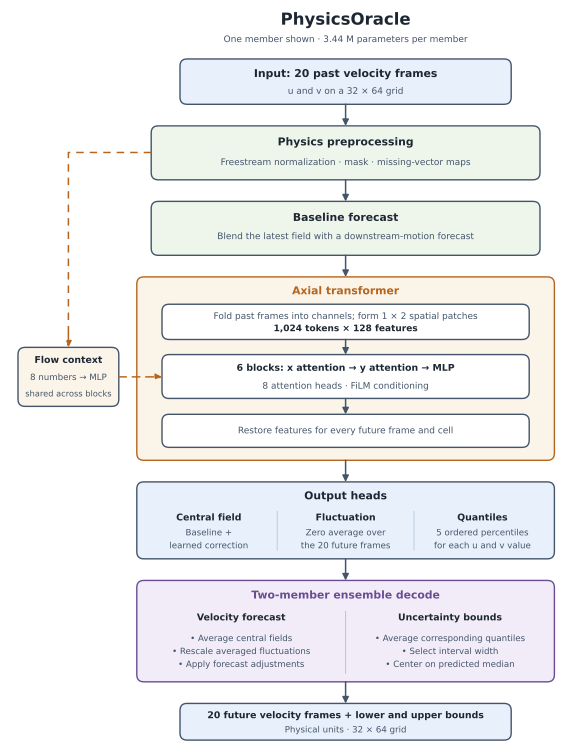
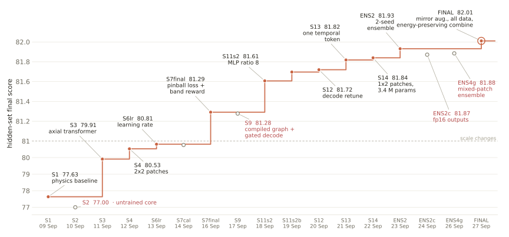

# PhysicsOracle: Track 1 method

## 1. Summary
A physics scaffold estimates the freestream velocity, reads the airfoil geometry from the PIV mask and builds a baseline forecast. A 3.4 M-parameter axial transformer predicts a correction to that baseline, a zero-mean fluctuation field and residual quantiles. What matters most is the axial transformer architecture allowing to predict high-frequency modes while maintaining low inference time and training cost.


## 2. Model
<p align="center">
  
</p>

The model takes **20 measured velocity frames on a 32 × 64 grid** and forecasts the next 20 frames, together with lower and upper uncertainty bounds. We combine two independently trained members, each with **3,440,787 parameters**.

**Physics scaffold.** We estimate the incoming flow speed from the nonzero streamwise velocities in the top eight rows and divide the input velocities by this estimate. This reduces differences in velocity scale between flow conditions. Cells with no streamwise measurement throughout the input window form a mask describing the airfoil and unmeasured regions. We also record how frequently measurements are missing at each cell.
The scaffold builds an initial forecast by blending the latest velocity field with a simple downstream-motion forecast. The latter takes the input’s time-average field and adds the latest frame’s deviation from that average, shifted downstream. Two learned scalars control the blend and the displacement. The transformer then learns corrections to this baseline.

**Axial transformer.** The 20 input frames are folded into channels, and neighboring cells are grouped into 1 × 2 patches. This produces 1,024 tokens, each represented by 128 features. Six transformer blocks with eight heads each exchange information first along the streamwise direction and then across it, followed by a feed-forward network. We don't use attention within the temporal dimension.
An additional vector of eight numbers describes the flow speed, relative time between frames, downstream displacement per frame, mask position and size, and whether the input is real or simulated. Through FiLM, these numbers adjust the scaling, offsets and contribution of each transformer sub-layer.

**Output heads.** For every future frame, grid cell and velocity component, the network produces three outputs: a correction to the baseline, a fluctuation contribution, and five estimated percentiles of the deviation from the corrected baseline. The fluctuation contribution is constrained to average to zero over the 20 forecast frames. The percentiles (10%, 25%, 50%, 75% and 90%) remain ordered and describe the predicted uncertainty.

**Ensemble decode.** We average the members’ corrected baselines and corresponding percentiles. We also average their fluctuation contributions per cell, then rescale them to compensate for fluctuation energy lost through averaging. Further adjustments damp fluctuations with forecast lead time and, above the estimated training range, shift the forecast toward the measured input average.

**Starting point.** We start with random initialization and do not use a provided baseline.


## 3. Data
**Training data and sampling.** We use 81 real PIV trajectories and 100 simulated trajectories, downsampled to the 32 × 64 evaluation grid. Each epoch contains 6,000 randomly sampled windows of 20 input and 20 target frames. Samples come from real data with 75% probability and simulation with 25% probability. Simulated regimes without corresponding real measurements receive twice the sampling weight of other simulated regimes. Window start positions are sampled uniformly across all valid positions. Simulation frames are subsampled to approximate the real data’s convective time step.

**Validation.** The final training run uses all data available, reserving no validation set. During development we used separate folds holding out whole Reynolds-number rows or selected Reynolds-number and angle combinations to explore the generalization capabilites. Using epoch 59 for submission was selected based on these hold out runs.

**Augmentation.** Simulated input and target frames receive real measurement masks, random missing vectors and noise to resemble PIV data. Each real or simulated window has a 50% probability of being reflected vertically, with the cross-stream velocity component negated. Sampling and augmentation are reproducible from the seed, epoch and sample index.

**Excluded data.** We exclude `train_real/7575_0`, identified by the organizers as a duplicate of `6300_0`. Simulated pressure is unused because it did not improve results.


## 4. Training
Both members follow the same training stage. They run sequentially with different seeds.

| Stage | Data | Loss | Optimizer and learning rate schedule | Steps or epochs | Batch size |
|---|---|---|---|---|---|
| 1, repeated for two seeds | Real and simulated windows, sampled 75/25 | Relative L2 on the central forecast and prediction; 4 × summed pinball losses; 0.2 × TKE-map loss; differentiable SPS reward from the 41st epoch | AdamW, betas (0.9, 0.95), learning rate 0.001, weight decay 0.05; 5 warm-up epochs followed by cosine decay over a 100-epoch schedule | Stop after 59 epochs: 750 steps per epoch, 44,250 steps per member | 8 |

**Training details.** We use bf16 mixed precision, gradient clipping at 1.0 and an exponential moving average (EMA) of the weights with decay 0.9995. Biases, normalization parameters and baseline scalars are exempt from weight decay. The central forecast is detached when computing the prediction, TKE and SPS losses. L2, pinball and SPS losses exclude missing target values. TKE uses full-field temporal variance. SPS coverage smoothing decreases from 0.02 to approximately 0.00802 by the stopping epoch.

**Checkpoint selection.** Each member ships its EMA weights after epoch 59, fixed in the configuration. The trainer also saves a checkpoint selected by the monitoring score, but that checkpoint is not used for submission.

**Seeds and observed variation.** We use seeds 3 and 4. At epoch 59, their monitoring scores are 85.88 and 85.91, with relative L2 errors of 0.0757 and 0.0755. These monitoring windows overlap with training data. On our hidden development set, the recorded single-members scored within a variance of about +/- 0.007 (replicating the codabench score).

## 5. Uncertainty bounds
**Quantiles.** Each member predicts five percentiles (10%, 25%, 50%, 75% and 90%) of the deviation from its central velocity forecast, trained with a pinball loss. We average corresponding percentiles across the two members.

**Probability curve.** We connect the predicted percentiles with straight lines to estimate cumulative probability. Beyond the outer percentiles, we extend the end segments and clip probabilities to `[0, 1]`.

**Width selection.** We test 32 preset full widths and select the one maximizing `probability inside × exp(−width / sigma)`. The fixed scale `sigma = 0.0563870259 m/s` controls the penalty for wider intervals.

**Bounds.** The interval is centered on the averaged central forecast plus the predicted median deviation. We reduce the selected width by 5%. In physical units:
  ```
  center = central velocity field + predicted median deviation
  lower = center − 0.95 × selected width / 2
  upper = center + 0.95 × selected width / 2
  ```


## 6. Inference (Track 1)
**Per call.** `predict` transfers the input through pinned host memory to the GPU and runs both members and decoding in one compiled graph. Batch sizes not precompiled are combined by combination of precompiled batch sizes. Predictions and bounds return as float32 arrays, with pressure zero.

**Precision.** The transformer core uses fp16. Preprocessing, output heads and decoding use fp32. Attention uses PyTorch’s math implementation.

**Compilation and loading.** AOTInductor compiles batch sizes 1, 2, 3, 4, 5 and 10 on the training GPU, with max-autotune. Initialization loads the graphs through their C API, warms them up and prepares buffers. No runtime compiler is needed. Compiled execution failures trigger an eager PyTorch fallback and is logged.

**Caching.** Loaded graphs, weights and reusable buffers remain in memory. Prediction results are not cached for reuse.

**Ensemble adjustments.** Central forecasts and quantiles are averaged. Averaged fluctuations are rescaled to retain energy, then damped linearly over time. For OOD samples, the forecast’s average is pulled toward the input average.

## 7. Speed
What we did for the Time score (91.862 on Codabench):
- Ahead-of-time compilation of the whole predict path into one graph per batch size, with no Python in the timed path.
- An fp16 core and a model of only 3.4 M parameters (moving from 10.4 M to 3.4 M parameters also improved generalization).
- All 20 input frames folded into one temporal token, so the core has 1024 tokens.
- Warm-up and buffer allocation at load time, and pinned host buffers.

We measured 1.1 ms per window at batch 5 on an A100, and 1.6 ms on an RTX 4090.

## 8. What mattered

<p align="center">
  
</p>


The changes that moved the hidden development score most, grouped by submission (Codabench `final_score`):

| Change | Effect |
|---|---|
| Physics baseline alone (fixed `beta=0.75` and `gamma=0.6`) | 77.63 |
| Axial transformer correcting the physics baseline | +2.28 |
| Improved training recipe: patching and time folding, learning rate, pinball loss and the differentiable band reward | +1.38 |
| Inference: ahead-of-time compilation, gated decode above the training Re range, wider MLP | +0.43 |
| Architecture: all 20 frames in one temporal token, 1 x 2 patches, 3.4 M instead of 10.4 M parameters | +0.12 |
| Two-seed ensemble in one compiled graph | +0.09 |
| Mirror augmentation, training on all frames, energy-preserving combine, fluctuation scale 0.70, band scale 0.95 | +0.08 |
| **Total**, from 77.63 (physics baseline) to 82.01 (submitted model) | **+4.38** |


## 9. Compute
- **Hardware of the run behind the submission:** NVIDIA RTX 4090, 504 GB RAM, 64 CPU cores
- **Training time:** Each member approximately trains for ~150 min until 100 epochs (so in total 2 x 150 min), but since we take the 59th epochs state for the final submission each member finishes after approximately ~85 min. The compilation afterwards takes an additional approximately ~15 min for both members combined as it places both in one graph. So in total (training 2 members + compilation) 85 * 2 + 15 = 185 min.
- **Peak GPU memory:** 3.17 GiB allocated by PyTorch per member (3.31 GiB reserved) 

## 10. References
- **Literature (selection):**
  - Axial attention: Ho et al., *Axial Attention in Multidimensional Transformers*, 2019.
  - FiLM: Perez et al., *FiLM: Visual Reasoning with a General Conditioning Layer*, AAAI 2018.
  - Frozen turbulence: Taylor, *The spectrum of turbulence*, Proc. R. Soc. A, 1938.
  - Pinball (quantile) loss: Koenker and Bassett, *Regression Quantiles*, Econometrica 1978.
- **Software:**
  - Framework and compilation: Python 3.10, PyTorch 2.2.2 with AOTInductor, and Triton 2.2.0. CUDA 12.1, cuDNN 8, and CUDA/C++ compiler tools are provided by the training image.
  - Data and configuration: NumPy 1.26.4, h5py 3.11.0, and PyYAML 6.0.1, as specified in the Dockerfile. h5py and PyYAML serve preprocessing and training; inference uses PyTorch, NumPy, and the Python standard library.
  - Scoring: the organizers’ scoring.py, Track 1 starting kit v9, supplies the evaluation subscores.
